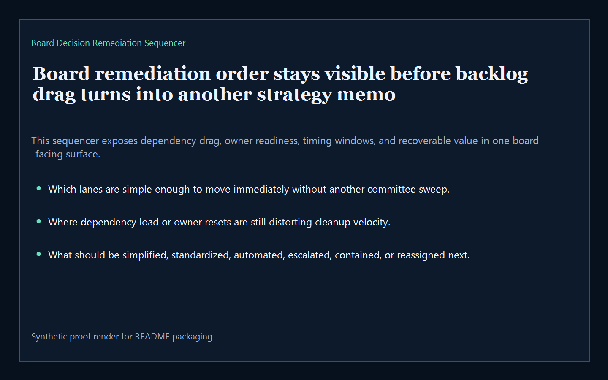
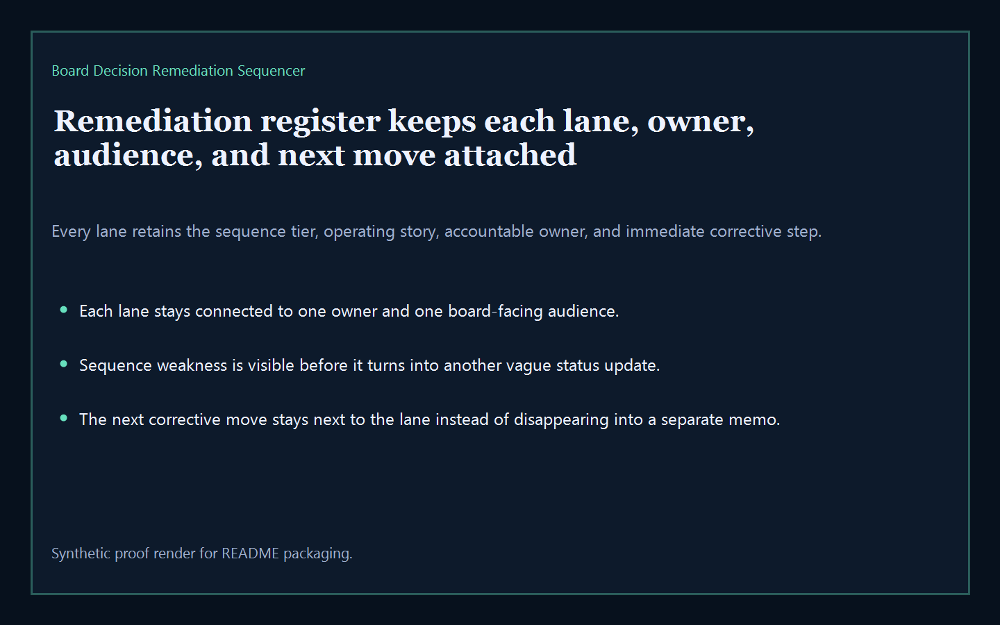
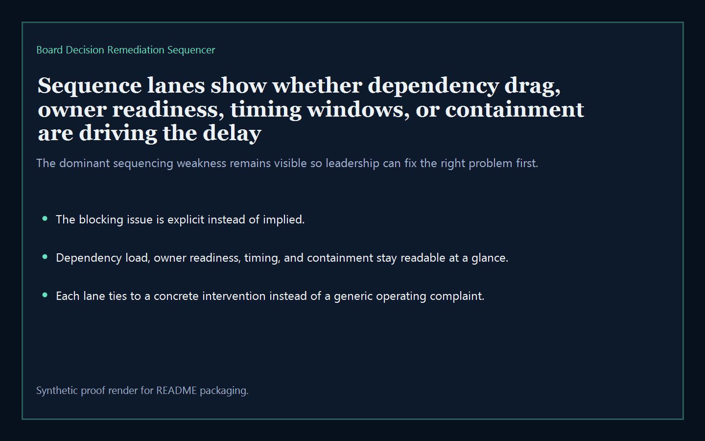
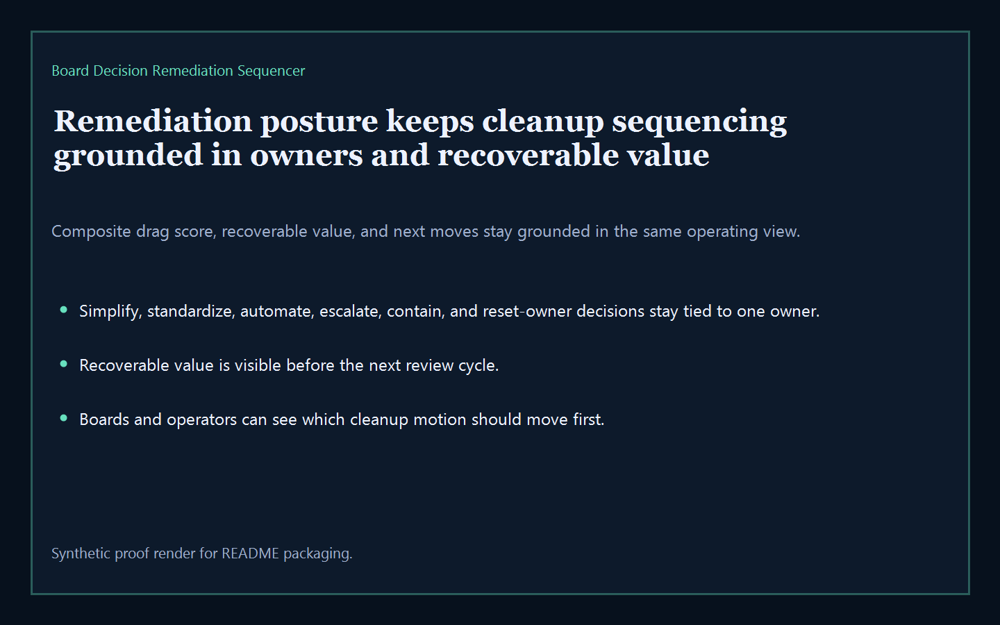

# Board Decision Remediation Sequencer

Board-ready executive-intelligence surface for sequencing remediation owners, dependencies, timing windows, and recoverable value across the broader Kinetic Gain suite.

- Live: `http://remediate.kineticgain.com/`
- Repo: `mizcausevic-dev/board-decision-remediation-sequencer`

## Why this matters

Leaders need one board-readable sequencing surface that shows which remediation motions should move first, which ones are blocked on owner resets or dependency cleanup, and where recoverable value is still trapped behind slow execution.

## What it includes

- TypeScript executive-intelligence surface for tracking remediation sequencing, owner readiness, dependency load, execution windows, and drag containment
- synthetic lanes across multiple sectors, owner groups, and board-visible remediation risks
- reusable outputs for remediation register, sequence lanes, posture narratives, and board-ready next-move prompts
- prerendered static site, JSON payloads, screenshots, and docs

## Routes

- `/`
- `/remediation-register`
- `/sequence-lanes`
- `/remediation-posture`
- `/verification`
- `/docs`

## Local run

```bash
cd board-decision-remediation-sequencer
npm install
npm run verify
npm run prerender
npm run render:assets
```

## CLI

```bash
npx board-decision-remediation-sequencer fixtures/board-decision-remediation-sequencer.json --format summary
npx board-decision-remediation-sequencer fixtures/board-decision-remediation-sequencer-clean.json --format json
```

## Docs

- [Architecture](docs/architecture.md)
- [Origin](docs/ORIGIN.md)
- [Kinetic Gain Embedded](docs/KINETIC_GAIN_EMBEDDED.md)

## Screenshots





